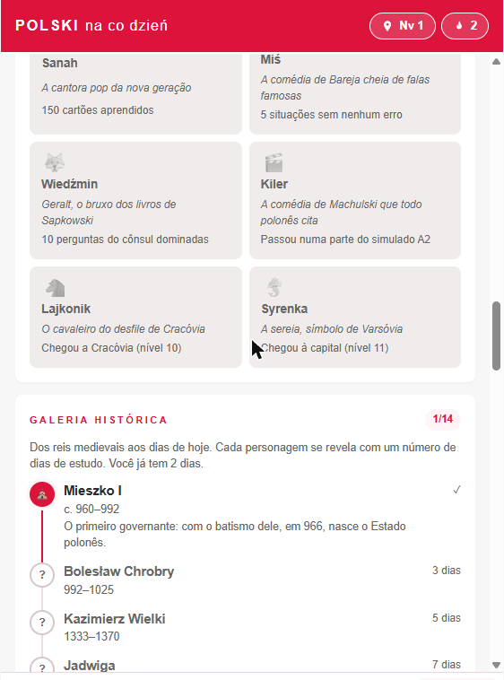

# POLSKI na co dzień

App gratuito para brasileiros aprenderem o polonês do dia a dia, do zero até o nível A2, com foco na entrevista da Karta Polaka.

**Abrir o app: https://srskywallker.github.io/POLSKI-na-co-dzie-/**

Funciona no navegador do celular ou do computador. Não precisa instalar nada nem criar conta.

> **Esta é a versão de protótipo**, feita para testar as funcionalidades e coletar feedback. O app final será desenvolvido para **Android e iPhone**, com login obrigatório e o progresso de cada usuário salvo no próprio celular.



## Como o app ensina

Cada conteúdo passa por quatro etapas, porque ler, entender, escrever e falar a mesma frase fixa o aprendizado:

| Etapa | O que você faz |
|---|---|
| 1 · Ler | Vê a frase em polonês e escolhe o significado. Tocar numa palavra mostra a tradução dela |
| 2 · Entender | Vê a frase em português e escolhe o polonês |
| 3 · Montar ou Ouvir | Nas frases: monta o polonês com blocos de palavras, a partir do português ou do áudio |
| 3 · Escrever | Digita a frase em polonês (tem teclado com ą, ć, ę, ł, ń, ó, ś, ź, ż) |
| 4 · Falar | Diz a frase no microfone e o app mostra o que entendeu |

Os cartões usam repetição espaçada: o que você erra volta mais cedo, o que você acerta volta cada vez mais tarde.

Durante a sessão:

- **O que você erra volta no fim da mesma sessão**, no mesmo tipo de exercício, marcado como "Erro anterior".
- **A cada 5 acertos seguidos**, o próximo cartão que você já conhece vira um desafio de escrever.
- **"Não posso ouvir agora"** troca os exercícios de ouvir por montar durante 15 minutos.
- **Depois de cada resposta**, dá para marcar o cartão como fácil demais ou difícil demais, o que muda quando ele volta, ou reportar um erro. O reporte abre uma issue já preenchida com o cartão.
- **Atalhos no computador:** as teclas 1 a 9 escolhem a opção ou o bloco, e Enter confere ou passa para o próximo.
- **No fim da sessão**, o app mostra a porcentagem de acerto e a melhor sequência.

## O que tem no app

| Aba | Conteúdo |
|---|---|
| Hoje | Lição do dia (até 12 revisões e 6 cartões novos), frase do dia, situação do dia e uma pergunta do cônsul |
| Cartões | 657 cartões em 34 temas: frases para usar, tempo e números, e vocabulário (casa, comida, saúde, trabalho, documentos, cidades da Polônia e mais). As cidades aparecem com um desenho do seu símbolo |
| Situações | 6 conversas: na padaria, conhecendo alguém, no restaurante, pedindo informação, ao telefone e no consulado. Você escolhe o que dizer e repete em voz alta |
| Entrevista | 20 perguntas do cônsul, com resposta modelo. Você responde falando ou escrevendo e compara com o modelo |
| Nível | Simulado adaptado da prova oficial A2 (compreensão oral, leitura e gramática), escrita com textos modelo e fala com microfone |
| Progresso | Jornada, coleção, conquistas, galeria histórica e mapa dos dias estudados |

A maior parte das frases tem áudio gravado em polonês. As demais usam a voz do navegador.

### As seções aparecem no momento certo

Para não distrair no começo, o app abre com Hoje, Cartões, Progresso e a prática principal do seu objetivo: a Entrevista para a Karta Polaka, ou as Situações para Família e Viagem. As outras seções aparecem conforme você sobe de nível na jornada:

| Seção | Karta Polaka | Família | Viagem | Cultura |
|---|---|---|---|---|
| Entrevista | desde o início | nível 4 | nível 5 | nível 5 |
| Situações | nível 3 | desde o início | desde o início | nível 3 |
| Treino de fala | nível 3 | nível 3 | nível 3 | nível 4 |
| Exame A2 | nível 4 | nível 5 | nível 5 | nível 6 |

A tela Hoje mostra uma ação principal por vez: primeiro a lição do dia; depois, a atividade que mais combina com o seu objetivo. Os cartões novos também chegam primeiro dos temas ligados ao objetivo. Quem quiser tudo de uma vez pode abrir todas as seções em Progresso → Ajustes.

## Para manter o ritmo ao longo das semanas

- **Jornada pela Polônia:** 11 níveis, de Wieliczka até Varsóvia. Cada atividade dá pontos (XP), e cada nível novo apresenta a cidade e uma palavra polonesa.
- **Coleção polonesa:** cada semana com 5 dias de estudo vale uma medalha e o próximo item da coleção (pierogi, pączek, oscypek, maluch…).
- **Conquistas:** 14 conquistas com nomes da cultura pop polonesa, de Reksio a Wiedźmin.
- **Galeria histórica:** 14 personagens, de Mieszko I a Olga Tokarczuk, revelados conforme você soma dias de estudo.
- **Bloqueios de sequência:** até 2 guardados. Cada um salva a sequência num dia sem estudo, e cada medalha da semana dá mais um.
- **Marcos da sequência:** 7, 14, 30, 50, 100, 200 e 365 dias seguidos ganham uma comemoração, com opção de compartilhar.
- **Objetivo:** na primeira vez, você escolhe por que está aprendendo (entrevista da Karta Polaka, família, viagem ou cultura). O app mostra a meta de nível e o próximo passo.

No fim de cada sessão de cartões, o app lista os cartões em que você errou e oferece treiná-los na hora. O botão de tartaruga toca o áudio mais devagar.

## Microfone

O reconhecimento de voz é o do próprio navegador, em polonês:

- Funciona no **Chrome** (computador e Android) e no **Safari** (iPhone e Mac). No Firefox não funciona.
- Na primeira vez, o navegador pergunta se pode usar o microfone.
- O navegador envia o áudio para transcrição: o Chrome usa os servidores do Google, e o Safari os da Apple. O app guarda só o texto reconhecido, e só durante o exercício.
- O app perdoa a falta de acentos e pequenos erros de reconhecimento. A nota mostra se a frase foi entendida, não avalia o sotaque em detalhe.

## Onde fica o seu progresso

Neste protótipo, o progresso fica salvo no próprio navegador do aparelho. Ele não passa para outro aparelho ou navegador, e some se você limpar os dados do site. No app final para Android e iPhone, cada usuário vai entrar com login e ter o próprio progresso salvo no celular.

## Exemplos com uma persona fictícia

As frases de apresentação, a entrevista e os textos modelo usam uma persona inventada: **Lucas Openchoski**, de Curitiba. A história dos antepassados é inspirada numa família real: Wincenty e Franciszek Opęchowski, da região de Ciechanów, que chegaram ao Rio de Janeiro no navio Berlin em 1890 e foram viver na Colônia Guaporé, no Rio Grande do Sul. A grafia do sobrenome mudou, primeiro nos registros russos e depois no Brasil.

Nomes e sobrenomes poloneses aparecem sempre na grafia original, com todas as letras do polonês (Józef, Stanisław, Mikołaj Kopernik, Lech Wałęsa). Troque pelos seus dados ao treinar.

## Dar feedback

Achou um erro de polonês, um problema no app ou tem uma ideia? Abra uma [issue](https://github.com/Srskywallker/POLSKI-na-co-dzie-/issues) contando o que aconteceu, em qual aparelho e em qual navegador.

## Para quem quer mexer no código

- O app inteiro é um único arquivo, [`index.html`](index.html), com HTML, CSS, JavaScript e os áudios embutidos. Não tem etapa de build nem dependências.
- Para rodar localmente, abra o arquivo no navegador. Para testar o microfone, sirva a pasta por `localhost`, porque o navegador só libera o microfone em `https` ou `localhost`:
  ```
  python -m http.server 8000
  ```
  e abra http://localhost:8000.
- O site é publicado pelo GitHub Pages a partir da branch `main`. Cada envio para a `main` atualiza o site em cerca de 1 minuto.

## Fontes

- Simulado e estrutura da prova: adaptados da prova de exemplo oficial do nível A2 da Państwowa Komisja do Spraw Poświadczania Znajomości Języka Polskiego jako Obcego ([certyfikatpolski.pl](https://certyfikatpolski.pl)).
- Autoavaliação: escala oficial do Quadro Europeu Comum de Referência para Línguas (níveis A1, A2 e B1).
